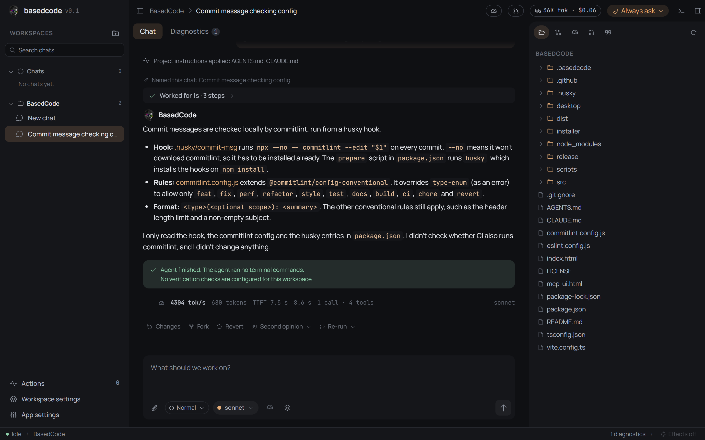
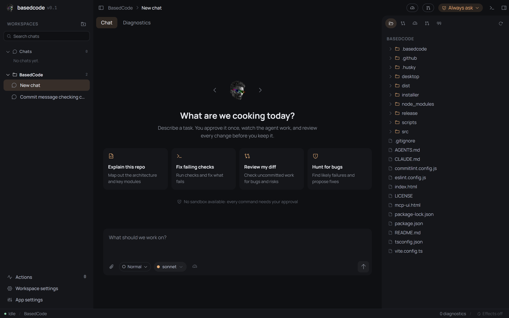
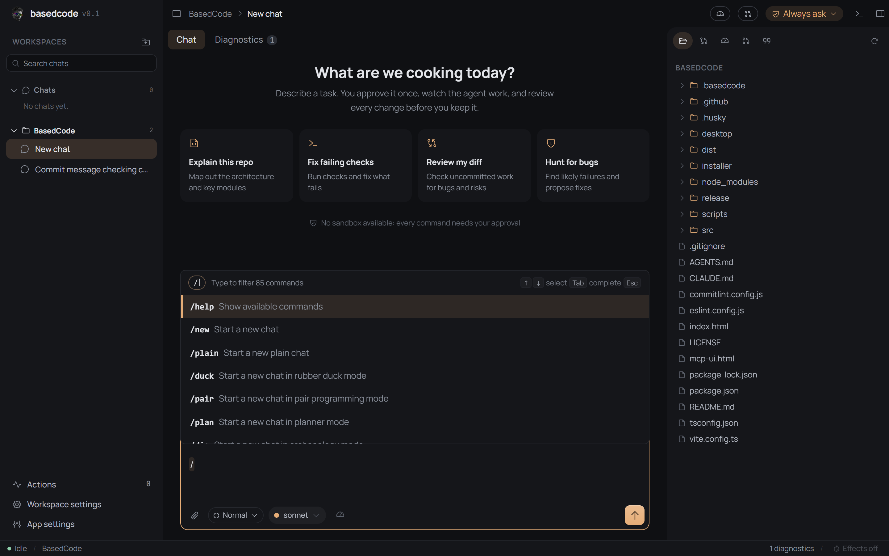
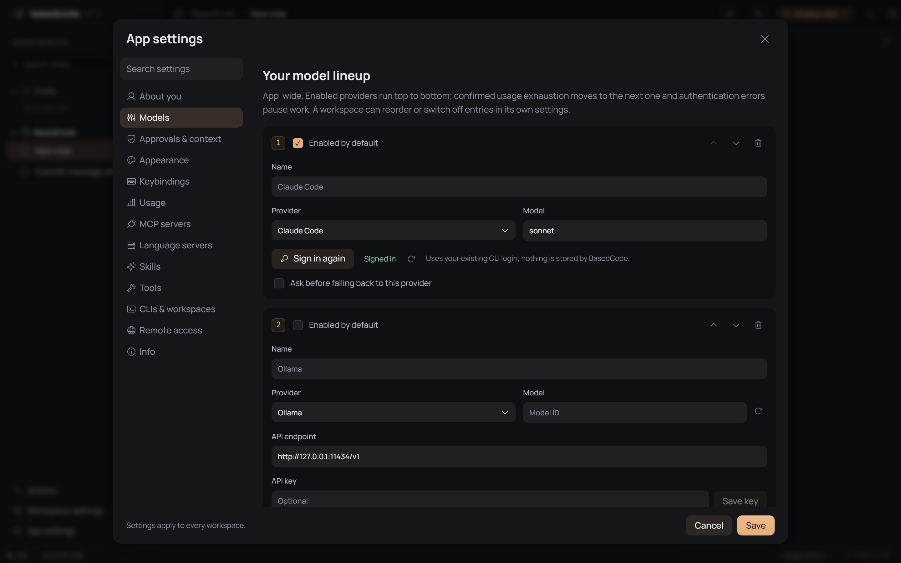

<p align="center">
  
</p>

# BasedCode

BasedCode is a desktop app for working on real codebases with an AI agent. You open a project folder, pick a model, and give the agent a task. The agent reads, edits, runs commands and checks its work through BasedCode's own tools. You approve what it does and can review or revert every change.

It works with Claude Code, Codex and Antigravity (using your existing CLI login) and with local models through Ollama or LM Studio. Every provider gets the same tools, permissions and history.

The jokes, fire effects and "Based" wording are part of the theme. You can switch to plain English or Dutch and turn the effects off in settings.

## What you can do with it

- **Chat with an agent about your code.** It explores, explains, plans and changes code in the folder you opened.
- **Use guided modes** such as rubber duck debugging, pair programming, code review, archaeology (why is the code like this?), testing and migrations. Type `/` in the message box to see them all.
- **Stay in control.** Terminal commands and Git changes need your approval. You can set allow/deny rules and per-run budgets.
- **Review and undo.** See diffs per prompt, and revert the workspace to any earlier prompt.
- **Extend it** with MCP servers, workspace skills (`.basedcode/skills/<name>/SKILL.md`) and `AGENTS.md`/`CLAUDE.md` project instructions, which load automatically.

## Screenshots

<table>
  <tr>
    <td align="center" width="50%"><br><sub>The agent answers a question, reading files through BasedCode's tools.</sub></td>
    <td align="center" width="50%"><br><sub>Start a chat or pick a suggested task.</sub></td>
  </tr>
  <tr>
    <td align="center" width="50%"><br><sub>Type <code>/</code> for commands and guided modes.</sub></td>
    <td align="center" width="50%"><br><sub>Set up providers and their fallback order.</sub></td>
  </tr>
</table>

Screenshots are taken with effects off and the language set to English.

## Set it up

You need:

- **Node.js 24 or newer**. BasedCode refuses to start on older versions.
- **Windows or Linux.** macOS is not supported yet.
- At least one model provider (see below).

Install and start it from source:

```bash
git clone https://github.com/Naamloos/BasedCode.git
cd BasedCode
npm install
npx camoufox-js fetch   # optional: browser for the agent's browser tools
npm run build
npm start
```

The first start downloads the NW.js runtime, then the BasedCode window opens.

> **npm 11 and install scripts:** recent npm versions may skip package install scripts and print `npm warn install-scripts`. BasedCode needs native modules (`node-pty`, `better-sqlite3`) and `nw`. If the app fails to start after a fresh install, run `npm install-scripts ls`, approve the listed packages with `npm install-scripts approve <pkg>`, and run `npm install` again.

User data (chats, settings) is stored in `%LOCALAPPDATA%\BasedCode` on Windows and `~/.local/share/basedcode` on Linux. Set `BASEDCODE_DATA_DIR` to use another folder.

### Connect a provider

Log in once on the command line; BasedCode reuses that login.

| Provider | What to do |
| --- | --- |
| Claude Code | `claude login` |
| Codex | `codex login` |
| Antigravity | Install `agy` and sign in (`agy`, or use the sign-in button in BasedCode settings) |
| Ollama | `ollama serve`, then set the endpoint in BasedCode settings |
| LM Studio | Start the local server, then set the endpoint in BasedCode settings |

You can set an ordered fallback per workspace: when one provider runs out of quota, the next one continues.

## The first thing to try

Ask BasedCode to explain a project you know, so you can judge the answer.

1. Click to open a folder and choose one of your own projects.
2. Choose a provider and model.
3. Type `/dig` and press Enter. This starts a chat in archaeology mode, which only reads code and never changes it.
4. Ask something like:

   ```
   Why is [a file or function you know] implemented this way? Use the git history.
   ```

Watch the tool cards as the agent searches files and reads the history. Then try a normal chat with a small change, for example "add a test for X", and look at the diff and approval cards before you accept anything.

## Limitations

BasedCode is still in development.

- **No sandbox yet.** Commands run with your own user permissions. That is why every terminal command needs approval.
- MCP and language servers run as normal child processes.
- Reverting a prompt restores files only. It does not undo Git commits, branches, stashes or the index. Checkpoints skip dependency folders, links and very large files.
- Commits made by the app do not run Git hooks.
- Not supported yet: macOS, editing code in the built-in file viewer, subagents.

## For contributors

```bash
npm run dev          # Dev mode with hot reload (uses port 5317)
npm run typecheck
npm run lint
npm test
npm run package:win  # Windows installer, after npm run build
```

See [AGENTS.md](AGENTS.md) for how the code is organized and the conventions to follow.

## License

[GNU AGPLv3](LICENSE) © 2026 Ryan de Jonge